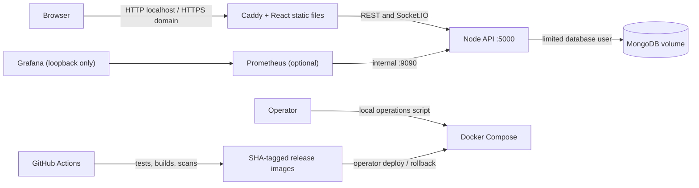

# Portable deployment architecture

## Decisions

- One host, one API process and one database keep the demo understandable and portable.
  This is a deliberate single point of failure, not high availability.
- Caddy serves the frontend and proxies the API and Socket.IO under one origin.
  No cloud-specific API gateway, load balancer or DNS product is required.
- API image is non-root/read-only, drops Linux capabilities, has a memory limit and
  is never host-published. Database and monitoring use an internal network.
- The database app user has readWrite only for securechat; the root credential is used
  only by database bootstrap and operator recovery.
- Prometheus joins the internal backend and a separate monitoring network; Grafana
  joins only the monitoring network. Only loopback dashboard ports are published.
- Metrics are on a separate internal listener, with low-cardinality route labels.
  Logs omit payloads and credentials; audit records retain limited identities.
- Compose profiles keep optional monitoring off smaller hosts.
- SHA tags, lockfiles, health waits and restore drills make releases reviewable.
  Base image tags still move for patches; record deployed digests for strict reproducibility.
- No Terraform is included yet: the portable deployment does not provision infrastructure.
  Provider-specific infrastructure can be added once a target and budget exist.

## Known limits

The browser chat now derives server-blind content keys with static identity ECDH and
pins peer fingerprints on first use. It does not provide forward secrecy, protection
against first-contact server key substitution, multi-device transfer or key recovery.
It remains a portfolio protocol that needs independent review before sensitive use.

Registration, authentication and authorization hardening are not a complete audit.
Files are sent in one capped JSON request; this is not a streaming large-file service.
Rate limits and metrics are process-local, and the app has no multi-instance Socket.IO adapter.
Local volumes are not replicated. Alert rules have no external notification receiver.

## Recruiter demonstration

1. Explain the architecture and the single-host cost/reliability tradeoff.
2. Show a green CI run and inspect a vulnerability report, including unresolved findings.
3. Start the same images with Compose, show readiness and a two-user socket exchange.
4. Open Grafana, generate traffic, and explain request latency and error-rate panels.
5. Stop MongoDB and demonstrate readiness changing, then recovery.
6. Back up, restore into the isolated check database, and explain downtime and missing client keys.
7. Deploy two immutable tags and roll back. Explain why schema compatibility matters.

Describe only verified outcomes on a resume. Suggested wording after validation:
"Built a cloud-portable Docker deployment for a chat application with Caddy, GitHub Actions,
health checks, Prometheus/Grafana monitoring, and tested backup/restore workflows."
Do not claim AWS deployment, production-grade E2EE, scale results or zero downtime without evidence.
